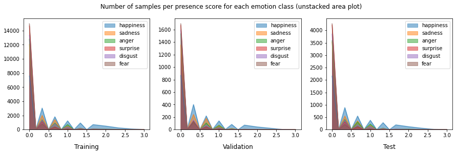

# SOTA models for Multimodal Emotion Recognition

:dart: This repository is intended to experiment state-of-the-art codes on Multimodal Emotion Recognition.

Feel free to open an issue on this repository if you have any question or remark. Thank you for your interest!


### README Structure

1. [CMU-MOSEI Database](#CMU-MOSEI-Database)
2. [Environment](#Environment)
3. [How to run the code](#How-to-run-the-code)
4. [Output generated](#outputs-generated)
5. [Data preprocessing and resulting statistics](#Data-preprocessing-and-resulting-statistics)
6. [Models available](#models-available)

## CMU-MOSEI Database

The CMU - *Multimodal Opinion Sentiment and Emotion Intensity* database is one of the key databases in Multimodal Emotion
Recognition.

  <p font="italic" align="center">  

  

  </p>

  <p font="italic" align="center">
  Source: http://multicomp.cs.cmu.edu/resources/cmu-mosei-dataset/
  </p>

### General description

- Modalities: Audio, Video, Text (transcript)
- Emotions: Anger, Disgust, Fear, Happiness, Sadness, Surprise + Neutral
- 23 453 YouTube videos covering 250 topics
- 1000 speakers facing the camera
- Speech language: English
- Wild emotions

```commandline
@inproceedings{Zadeh2018,
  title={{Multimodal Language Analysis in the Wild: CMU-MOSEI Dataset and Interpretable Dynamic Fusion Graph}},
  author={Zadeh, AmirAli Bagher and Liang, Paul Pu and Vanbriesen, Jonathan and Poria, Soujanya and Tong, Edmund and Cambria, Erik and Chen, Minghai and Morency, Louis-Philippe},
  booktitle={Proceedings of the 56th Annual Meeting of the Association for Computational Linguistics},
  pages={2236--2246},
  year={2018}
}
```

### SDK for data retrieval

The authors provide an SDK that can be found here: [CMU-Multimodal SDK](https://github.com/A2Zadeh/CMU-MultimodalSDK). 

Some useful details on the [CMU-Multimodal SDK](https://github.com/A2Zadeh/CMU-MultimodalSDK) used to retrieve CMU-MOSEI data:
- The handcrafted features provided by the SDK are **OpenFace 2** (image), **FACET 4.2** (image), **COVAREP** (audio), 
**glove_vectors** (text).
- The labels provided for each segment are: **[sentiment, happy, sad, anger, surprise, disgust, fear]** in this order,
with sentiment in range [-3,3] and the six emotions in range [0,3]. In this repository, we only focus on emotions.

[Go to top](#sota-models-for-multimodal-emotion-recognition) :arrow_up:

## Environment
- Python 3.9.7
- TensorFlow 2.8
- Keras 2.8
- NumPy 1.20.3
- pydot 1.4.2
- graphviz 0.20.1
- alive-progress 3.0.1

[Go to top](#sota-models-for-multimodal-emotion-recognition) :arrow_up:

## How to run the code
1. Clone [CMU MultimodalSDK](https://github.com/A2Zadeh/CMU-MultimodalSDK) and follow the installation steps outlined there.
2. Two ways to run the code:

   1. **Using bash script** (recommended, parameters can be set by editing the file):
   
    ```commandline
    ./run_cluster.sh
    ```
    

   2. **Running main.py in the command line:**

    ```commandline
     usage: main.py [-h] [-pnd PICKLE_NAME_DATASET] [-pnf PICKLE_NAME_FOLD] [-t] [-al]
               [-f {facet,openface}] [-c] [-mn MODEL_NAME] [-l NUM_LAYERS]
               [-n NUM_NODES] [-d DROPOUT_RATE] [-a FINAL_ACTIV] [-e NUM_EPOCHS]
               [-p PATIENCE] [-b BATCH_SIZE] [-lt {all,coarse,present,dominant}]
               [-opt {adam,sgd,adagrad,adadelta,rmsprop}] [-lf LOSS_FUNCTION]
               [-lr LEARNING_RATE] [-v {loss,acc}] [-nc]
               [-tp THRESHOLD_EMO_PRESENT [THRESHOLD_EMO_PRESENT ...]]
               [-rd ROUND_DECIMALS] [-sp] [-pcm] [-df]

    SOTA Multimodal Emotion Recognition models using CMU-MOSEI database.
    
    optional arguments:
      -h, --help            show this help message and exit
      -pnd PICKLE_NAME_DATASET, --pickle_name_dataset PICKLE_NAME_DATASET
                            Name of the pickle object that will contain the CMU-MOSEI
                            mmdataset.
      -pnf PICKLE_NAME_FOLD, --pickle_name_fold PICKLE_NAME_FOLD
                            Name of the pickle object that will contain the training,
                            validation and test folds.
      -t, --align_to_text   Data will be aligned to the textual modality.
      -al, --append_label_to_data
                            Append annotations to the dataset.
      -f {facet,openface}, --image_feature {facet,openface}
                            Image features. Values: facet or openface.
      -c, --with_custom_split
                            Perform custom split on training and validation sets (for more
                            details, cf. Williams et al. (2018) paper).
      -mn MODEL_NAME, --model_name MODEL_NAME
                            Name of the model currently tested. Values: ef_williams.
      -l NUM_LAYERS, --num_layers NUM_LAYERS
                            Number of bidirectional layers.
      -n NUM_NODES, --num_nodes NUM_NODES
                            Number of nodes in the penultimate dense layer.
      -d DROPOUT_RATE, --dropout_rate DROPOUT_RATE
                            Dropout rate
      -a FINAL_ACTIV, --final_activ FINAL_ACTIV
                            Activation function of the final layer.
      -e NUM_EPOCHS, --num_epochs NUM_EPOCHS
                            Maximum number of epochs
      -p PATIENCE, --patience PATIENCE
                            Number of epochs with no improvement after which the training
                            will be stopped.
      -b BATCH_SIZE, --batch_size BATCH_SIZE
                            Batch size
      -lt {all,coarse,present,dominant}, --label_type {all,coarse,present,dominant}
                            Type of labels used for model training and evaluation.
                            Possible values: all (for all presence scores provided by
                            the dataset), coarse (presence score for each emotion among
                            [0, 1, 2, 3]), present (multi-label classification),
                            dominant (multi-class one-label classification)
      -opt {adam,sgd,adagrad,adadelta,rmsprop}, --optimizer {adam,sgd,adagrad,adadelta,rmsprop}
                            Optimizer for model training. Values: adam, sgd, adagrad,
                            adadelta, rmsprop.
      -lf LOSS_FUNCTION, --loss_function LOSS_FUNCTION
                            Loss function
      -lr LEARNING_RATE, --learning_rate LEARNING_RATE
                            Learning rate
      -v {loss,acc}, --val_metric {loss,acc}
                            Metric to monitor for validation set. Values: loss or acc.
      -nc, --predict_neutral_class
                            Predict neutral class.
      -tp THRESHOLD_EMO_PRESENT [THRESHOLD_EMO_PRESENT ...], --threshold_emo_present 
          THRESHOLD_EMO_PRESENT [THRESHOLD_EMO_PRESENT ...]
                            Threshold at which emotions are considered to be present.
                            Values must be between 0 and 3. Note that setting thresholds
                            greater than 0 might lead to no positive true and predicted
                            classes and skew classification metrics (F1, precision,
                            recall).
      -rd ROUND_DECIMALS, --round_decimals ROUND_DECIMALS
                            Number of decimals to be rounded for metrics.
      -sp, --save_predictions
                            Save predictions with pickle
      -pcm, --plot_confusion_matrix
                            Plot confusion matrix
      -df, --display_fig    Whether we display the figures

    ```

### Useful parameters to set
`--label_type {all,coarse,present,dominant}`: Choose the task the model has to perform for model training and evaluation.
- **all** is to estimate the presence score provided by the dataset [0, 0.16, 0.33, 0.5, 0.66, 1, 1.33, 1.66, 2, 2.33, 2.66, 3]
for each emotion
- **coarse** is to estimate the presence score among [0, 1, 2, 3] for each emotion
- **present** is to classify each emotion as present (1) or not present (0) in the sample
- **dominant** is to assign a single emotion (the dominant one) to the sample

`--predict_neutral_class`: Whether we predict neutral class 

[Go to top](#sota-models-for-multimodal-emotion-recognition) :arrow_up:

## Outputs generated

All words in curly brackets (except `id`) are parameters that can be set (cf. previous section). 
`id` is the model identifier: its parameter is shown in `model_ids.csv` file (cf. fourth row of the table).

Some pickle names have an extension: 
- *_emo*: annotations only limited to the six emotions (sentiment excluded)
- *_with_n*: annotations include the neutral class

| Objects                        | Files                                                                                                                                                  | Description                                                                                                                                                                                                                                                                                                                                                                                                                                                                                                                                                                                                             | Folder                                         |
|--------------------------------|--------------------------------------------------------------------------------------------------------------------------------------------------------|-------------------------------------------------------------------------------------------------------------------------------------------------------------------------------------------------------------------------------------------------------------------------------------------------------------------------------------------------------------------------------------------------------------------------------------------------------------------------------------------------------------------------------------------------------------------------------------------------------------------------|------------------------------------------------|
| Dataset                        | `{pickle_name_dataset}.pkl`                                                                                                                            | mmdataset object obtained from CMU-MOSEI SDK                                                                                                                                                                                                                                                                                                                                                                                                                                                                                                                                                                            | cmu_mosei/<br>mmdataset/                       |
| Fold                           | `{pickle_name_fold}_train.pkl` <br> `{pickle_name_fold}_valid.pkl` <br> `{pickle_name_fold}_test.pkl`                                                  | Lists of 3 elements for training, validation, and test sets respectively: <br> - **features (x)**: list of arrays of shape (number steps, number features) for text/image/audio features (concatenated in this order) <br> - **labels (y)**: list of arrays of shape (1, 7) for the 7 emotions <br> - **segment ids (seg)**: list of ids of the segment described by (x, y). Example: 'zk2jTlAtvSU[1]'                                                                                                                                                                                                                  | cmu_mosei/<br>raw_folds/                       |
| Model ids                      | `model_ids.csv`                                                                                                                                        | List of ids for each model, with the model architecture and training parameters. Useful for identifying models when saving metrics in csv files (cf. **Metrics** row)                                                                                                                                                                                                                                                                                                                                                                                                                                                   | results/<br>*model_name*/csv/                  |
| Models                         | `model_{id}.h5`                                                                                                                                        | Best model with a given set of hyperparameters                                                                                                                                                                                                                                                                                                                                                                                                                                                                                                                                                                          | results/<br>*model_name/*<br>models/           |
| History                        | `history_{id}.pkl`                                                                                                                                     | Model training history                                                                                                                                                                                                                                                                                                                                                                                                                                                                                                                                                                                                  | results/<br>*model_name/*<br>history/          |
| True labels from test set      | `true_scores_all.pkl` <br> `true_scores_coa.pkl` <br> `true_classes_pres.pkl` <br> `true_classes_dom.pkl`                                              | All are arrays of shape (test size, number classes) with number of classes equal to 7 with the neutral class, or 6 without. <br><br> Represent the true labels with different granularity: <br> **scores_all**: presence scores provided by the annotations, with values among [0, 0.16, 0.33, 0.5, 0.66, 1, 1.33, 1.66, 2, 2.33, 2.66, 3] <br> **scores_coa**: coarse presence scores with values among [0, 1, 2, 3] <br> **classes_pres**: binary array detecting the presence of an emotion (presence score > 0) <br> **classes_dom**: binary array identifying the dominant emotion(s) (the highest presence score) | cmu_mosei/<br>processed_folds/                 |
| Predicted labels from test set | `pred_raw_{id}.pkl` <br> `pred_scores_all_{id}.pkl` <br> `pred_scores_coa_{id}.pkl` <br> `pred_classes_pres_{id}.pkl` <br> `pred_classes_dom_{id}.pkl` | Files generated with `--save_predictions` argument. <br><br> The predicted presence scores or class. **pred_raw** gives the raw presence scores predicted by the model. For the rest, cf. description above done for "True labels from test set".                                                                                                                                                                                                                                                                                                                                                                       | results/<br>*model_name/*<br>predictions/      |
| Confusion matrix               | `conf_matrix_{id}`<br>`_t_{thres}.pkl`                                                                                                                 | File generated with `--plot_confusion_matrix` argument.<br><br> Multilabel confusion matrix based on the presence/absence of each emotion with a presence score threshold *thres*                                                                                                                                                                                                                                                                                                                                                                                                                                       | results/<br>*model_name/*<br>confusion_matrix/ |
| Metrics                        | `regression.csv` <br> `classif_score_coarse.csv`  <br> `classif_pres_t_{thres}.csv`  <br> `classif_dom.csv`                                            | CSV files with all the metrics: <br> **regression**: Regression metrics calculated from the closeness with the presence score <br> **classif_score_coarse**: Classification metrics based on presence score (from 0 to 3) for each emotion <br> **classif_pres**: Classification metrics based on the presence/absence of an emotion (presence score >= thres) <br> **classif_dom**: Classification metrics based on identifying the dominant emotion(s) (the highest presence score)                                                                                                                                   | results/<br>*model_name*/csv/                  |

[Go to top](#sota-models-for-multimodal-emotion-recognition) :arrow_up:


## Data preprocessing and resulting statistics

This section presents the work conducted on feature data and labels, as well as the statistics obtained after the data preprocessing step.

### Preprocessing of feature data
Based on [this tutorial on CMU-Multimodal SDK](https://github.com/Justin1904/CMU-MultimodalSDK-Tutorials/blob/master/tutorial_interactive.ipynb) 
(recommended by the authors of CMU-MOSEI), here are the steps undertaken:

1. The following datapoints are removed:
   - datapoints with one or two missing modalities
   - the three modalities do not have the same number of time steps
   - datapoints that do not belong to any of the training, validation and test id lists provided by the SDK
2. All NaN are replaced by numbers
3. Visual and acoustic modalities are z-normalised

The output structure of the processed data from the function `process_and_split_dataset` is the following 
(example with the training set `train_list`):

  <p font="italic" align="center">  

  

  </p>

### Preprocessing of labels
The labels are processed based on the targeted task chosen by the user (can be set by the parameter `label_type`):
- `all`: original presence scores provided by the dataset
- `coarse`: presence score for each emotion among [0, 1, 2, 3]
- `present`: one-hot encoded labels for multi-label classification
- `dominant`: one-hot encoded labels for one-label classification

### Data split statistics

|            | # of samples | Proportion |
|------------|--------------|------------|
| Training   | 16315        | 71.43%     |
| Validation | 1871         | 8.19%      |
| Test       | 4654         | 20.38%     |

### Label statistics

The two diagrams below show the label distribution for training, validation and test sets. 
It is worth noting that "happiness" is more expressed in the videos than the other 
emotion classes (the blue area is larger when the presence score is high). If you want to manipulate statistics and
generate other graphs, please refer to `label_statistics.ipynb` file.

  <p font="italic" align="center">  

  

  </p>

  <p font="italic" align="center">  

  

  </p>

[Go to top](#sota-models-for-multimodal-emotion-recognition) :arrow_up:

## Models available

*The current code only runs the following model. We aim to add more models in this repository.*

Want to try one of the following models? Set `--model_name` parameter with the string value in bold.

- **ef_williams**: Williams, J., Kleinegesse, S., Comanescu, R., & Radu, O. (2018, July). [Recognizing Emotions in Video Using Multimodal DNN Feature Fusion](http://www.aclweb.org/anthology/W18-3302). In *Proceedings of Grand Challenge and Workshop on Human Multimodal Language (Challenge-HML)* (pp. 11-19). 
   - Updated version of [Multimodal DNN](https://github.com/rhoposit/MultimodalDNN)
   - Use standard training, validation and test sets from CMU-MOSEI SDK (instead of using only training and validation sets 
originally specified in the paper)

[Go to top](#sota-models-for-multimodal-emotion-recognition) :arrow_up:
